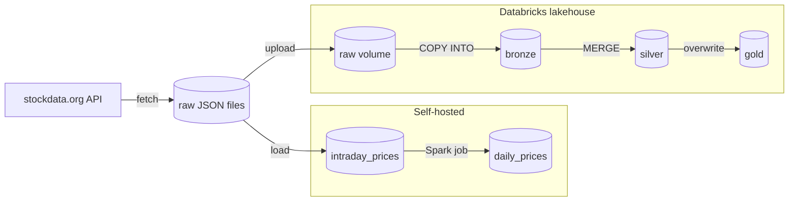
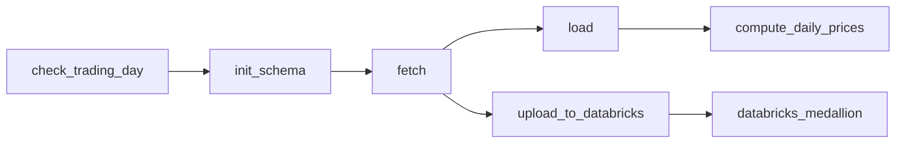
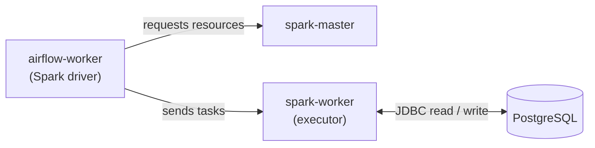

# market-tracker


Batch pipeline that ingests intraday stock prices from the [stockdata.org](https://www.stockdata.org/) API and builds daily candles with metrics. Raw files are processed along two paths: a self-hosted one (PostgreSQL + Apache Spark) and a lakehouse one on Databricks (Delta Lake, bronze/silver/gold). Orchestrated with Apache Airflow 3, running in Docker Compose.

**Stack:** Python · Airflow 3 · Spark 4 (PySpark) · Databricks · Delta Lake · Unity Catalog · PostgreSQL · SQLAlchemy · Docker · pytest · Ruff · GitHub Actions

## Architecture

**Data flow**



**DAG**



**Spark job at runtime**



## How it works

The `market_tracker` DAG runs daily at 22:00 UTC and processes one trading day per run:

| Task | What it does |
|---|---|
| `check_trading_day` | Skips the run if the NYSE was closed on the target day |
| `init_schema` | Creates the database tables if they don't exist |
| `fetch` | Saves the raw API response to a partitioned JSON file (per ticker, in parallel) |
| `load` | Upserts the file's rows into `intraday_prices` |
| `upload_to_databricks` | Uploads the same raw file to a Unity Catalog volume |
| `compute_daily_prices` | Submits the Spark job to the local cluster |
| `databricks_medallion` | Triggers the Databricks Job (bronze → silver → gold) and waits for it to finish |

### Spark job

| Step | Function | What it does |
|---|---|---|
| Read | `read_prices` | Loads `intraday_prices` over JDBC |
| Aggregate | `aggregate_daily` | Builds one candle per ticker and day: first `open`, max `high`, min `low`, last `close`, summed `volume`. Extended-hours bars are excluded |
| Enrich | `add_daily_metrics` | Adds `prev_close`, `daily_return` and `ma_7` (7-row moving average) with window functions |
| Write | `write_daily_prices` | Truncates `daily_prices` and writes the full result |

Airflow submits the job with `SparkSubmitOperator` to a Spark standalone cluster running in Compose. The driver only plans the job and coordinates the executor. Data moves between the executor and the database and never passes through the Airflow container.

At this data volume plain SQL would be enough. Spark is used here to practise the tool on a realistic pipeline.

### Databricks lakehouse

Raw files land in a Unity Catalog volume and are processed by a Databricks Job with three notebooks. Each layer is a Delta table in its own schema.

| Layer | Table | Notebook | What it does |
|---|---|---|---|
| Bronze | `market_bronze.intraday_responses` | `01_bronze` (SQL) | One row per raw API response, unchanged, plus ingestion metadata (`loaded_at`, `file_modified_at`, `source_path`). Loaded with `COPY INTO`, so re-runs skip files that were already loaded |
| Silver | `market_silver.intraday_candles` | `02_silver` (SQL) | One row per candle: nested array exploded, columns typed and renamed, timestamps converted to UTC, duplicates removed (latest file wins). Loaded with a conditional `MERGE` that only updates rows whose values changed |
| Gold | `market_gold.daily_prices` | `03_gold` (PySpark) | Daily candles and metrics, one row per `(ticker, source_interval, date)`. Reuses `aggregate_daily` and `add_daily_metrics` from `market_tracker.spark.transformations`, so both paths share the same tested logic. Fully recomputed on every run, because metrics depend on previous days |

The Job runs the notebooks straight from this repository, so it always executes versioned code. The schemas and the volume are created by `databricks/setup.sql`.

## Key features

- **Idempotent** - re-running a date doesn't duplicate rows; `COPY INTO` tracks loaded files, silver uses `MERGE`, gold and `daily_prices` are fully refreshed
- **Backfills** - each run processes the day given by its `logical_date`
- **Layered data** - raw files, intraday rows and daily candles are kept separately, locally and as a bronze/silver/gold medallion in Databricks
- **Shared transformations** - the same Spark functions run on the local cluster and in Databricks
- **Failure isolation** - each ticker is fetched, loaded, uploaded and retried independently, and the local and Databricks paths don't block each other
- **Tested** - unit tests (including Spark transformations) and linting run on every push

## Data issues found along the way

Building the silver layer and checking it against bronze surfaced several problems with the source data:

- **Wrong time zone** - the API marks timestamps as UTC (`...Z`), but session hours (09:30-16:00 for minute bars) show they are New York time. Silver parses them as local time and converts `America/New_York` to UTC, which also handles daylight saving time
- **Duplicated candles** - the same candle appeared in up to 12 files. In PostgreSQL this was silently hidden by `ON CONFLICT DO NOTHING`; uniqueness checks in silver exposed it
- **Wrong date range** - for some requests the API returned data from a different period than requested (visible in the response's `meta.date_from` / `meta.date_to`), so files named after one date contained another
- **Empty responses** - some weekday responses contain no candles; bronze keeps them, silver drops them naturally
- **Shorter minute history** - minute bars cover far fewer days than hourly bars, so gold computes daily candles per source interval instead of mixing them

## Setup

Requires Docker with at least 4 GB of memory and a free API key from [stockdata.org](https://www.stockdata.org/).

1. Create `.env` from `.env.example` and fill in `STOCKDATA_API_TOKEN` and `FERNET_KEY`. Generate the key with:
   ```bash
   python -c "import base64, os; print(base64.urlsafe_b64encode(os.urandom(32)).decode())"
   ```
2. Set tickers and interval in `dags/pipeline_config.yaml`.
3. Start the stack:
   ```bash
   docker compose build
   docker compose up airflow-init
   docker compose up -d
   ```
4. Open the Airflow UI at <http://localhost:8080> (login `airflow` / `airflow`) and unpause the `market_tracker` DAG.

The Spark master UI is at <http://localhost:8081> and the market database at `localhost:5433`.

### Databricks (optional)

Works on [Databricks Free Edition](https://www.databricks.com/learn/free-edition).

1. Run `databricks/setup.sql` in the SQL editor to create the schemas and the raw volume.
2. Create a Job with three notebook tasks (`01_bronze` → `02_silver` → `03_gold`) from `databricks/notebooks/`, using this repository as the Git source.
3. Add to `.env`: `DATABRICKS_HOST`, `DATABRICKS_TOKEN` (personal access token) and `DATABRICKS_MEDALLION_JOB_ID`, then recreate the containers.
4. Upload existing raw files once:
   ```bash
   python -m market_tracker.databricks.upload
   ```

## Usage

```bash
# Run the DAG for a single date
docker compose exec airflow-scheduler airflow dags test market_tracker 2026-09-29

# Backfill a date range
docker compose exec airflow-scheduler airflow backfill create --dag-id market_tracker --from-date 2026-09-01 --to-date 2026-09-30
```

The target day is the run date minus `API_DELAY_DAYS` (4), so pick run dates accordingly.

## Development

```bash
python -m venv venv
venv\Scripts\activate        # Windows
# source venv/bin/activate   # Linux/Mac
pip install -r requirements-dev.txt
pip install -e .
pre-commit install

pytest
ruff check .
```

Spark tests need Java 17 or 21. Tests use no database or network access. Databricks notebooks are excluded from Ruff.

## Project structure

```
dags/                       # DAG definition and pipeline config
databricks/
├── setup.sql               # Unity Catalog schemas and raw volume
└── notebooks/              # 01_bronze, 02_silver, 03_gold
src/market_tracker/
├── fetch.py                # API client, writes raw files
├── load.py                 # loads raw files into PostgreSQL
├── trading_calendar.py     # NYSE trading day check
├── databricks/upload.py    # uploads raw files to the Databricks volume
├── db/                     # engine, models, schema
└── spark/
    ├── session.py          # SparkSession builder
    ├── postgres.py         # JDBC read and write
    ├── transformations.py  # daily aggregation and metrics (shared with Databricks)
    └── jobs/daily_prices.py
tests/
```

## Known limitations and roadmap

- Missing trading days make `daily_return` and the moving average span a longer period
- `fetch` doesn't yet check that the returned range (`meta`) matches the requested day
- A day with no data fails `load` and blocks the local Spark job (the Databricks path still runs)
- `daily_prices` and gold are fully recomputed instead of updated incrementally
- The Databricks Job is defined in the UI, not in code
- Planned: range validation in ingestion, data quality checks, Databricks Asset Bundles, Azure deployment (ADLS Gen2 + Azure Databricks), dbt transformations